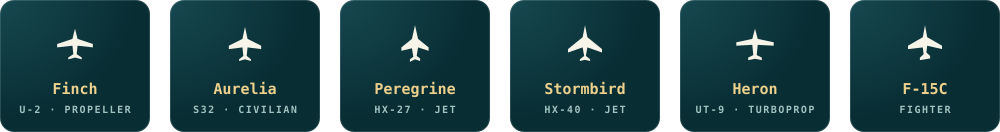
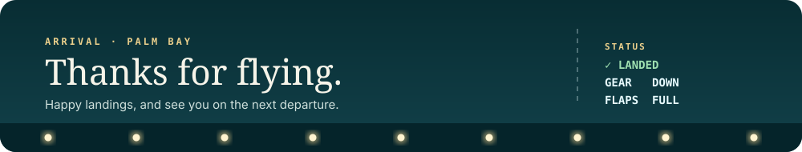

<h1 align="center"></h1>

Pocket Flight is a browser flight game with six aircraft, missions, free flight, a glass instrument HUD, adaptive audio, and Scene Studio. A separate private wind-tunnel app uses the shared aircraft and flight models for experiments and inspection.

**TypeScript · React · Three.js · Vite · Bun**

[Run locally](#run-locally) · [Find the code](#find-the-code) · [Development checks](#development-checks) · [Saved projects](#saved-projects) · [Agent guide](AGENTS.md)


## Run locally

From this repository (`pocket-flight-site/`):

```sh
bun install
bun run dev
```

Open the local URL printed by Vite. Choose an aircraft, then **First light** for a runway departure or **Free flight** to explore. Hold **Shift** for power; gently hold **↓ / S** to raise the nose at the rotation speed shown in the HUD. To land, close the throttle with **Ctrl**: the gear and flaps come down and the HUD shows your approach speed. Jets can hold **B** to slow down faster. The controls panel gives aircraft-specific guidance. Flight assistance can be changed in Settings.

The game requires a browser with WebGL. Runtime assets are already under `public/`; ordinary development does not require Blender, Python, API keys, or an application server beyond Vite.



| Experience                          | Local route                                             |
| ----------------------------------- | ------------------------------------------------------- |
| Game, HUD, replay, and Scene Studio | `/` — open Studio from the game UI                      |
| Fleet aircraft viewer | `/aircraft.html?aircraft=f15c` — choose any of the six aircraft; uses the flight models and moving systems |
| Finch U-2 viewer                    | `/hangar.html`                                          |
| Aurelia S32 viewer                  | `/civilian.html`                                        |
| Aurelia Phenom-based reconstruction | `/aurelia-reference.html` — enlarged airframe, original-size fittings, mechanisms, animated cockpit and cabin inspection |
| Peregrine HX-27 viewer              | `/jet.html`                                             |
| Stormbird HX-40 viewer              | `/stormbird.html`                                       |
| Heron UT-9 utility turboprop viewer | `/heron.html`                                          |
| Palm Bay scenery viewer             | `/scenery.html`                                         |
| Studio walkthrough and manual       | `/scene-studio-guide.html`, `/scene-studio-manual.html` |

These are separate Vite entry pages. Their URLs are independent of the internal source folder names.

The Aurelia reference cockpit accepts typed flight and map snapshots. See [Avionics data contract](docs/aircraft/AURELIA_AVIONICS.html) for units, the telemetry adapter, map coordinates and display lifecycle. The reference viewer uses an explicitly labelled demonstration source.

### Flight controls

| Action                       | Input                                |
| ---------------------------- | ------------------------------------ |
| Raise / lower nose           | **↓ / S** and **↑ / W**              |
| Bank left / right            | **← / A** and **→ / D**              |
| Rudder                       | **Q / E**                            |
| Increase / decrease throttle | **Shift / Ctrl**, or the HUD slider  |
| Speed brake (jets), wheel brakes | Hold **B** or **Space**          |
| Cycle camera                 | **C**                                |
| Look around                  | Hold **right mouse button** and drag |
| Zoom in the cockpit view     | Hold **Z**                           |
| Pause / resume               | **Esc / P**                          |
| Restart flight               | **R**                                |
| Toggle sound                 | **M**                                |

Touch controls are available in the flight HUD. Studio uses its own editing shortcuts.

### Private wind tunnel

```sh
bun run lab:dev
```

The lab runs separately at `http://127.0.0.1:5186`. It shares flight and aircraft modules with the game, but has its own UI, workers, assets, and Vite configuration. `bun run build` builds the game and viewers; `bun run lab:build` builds the lab into `output/wind-tunnel-build/`.


## Find the code

Source is grouped by the feature it belongs to. Filenames remain descriptive, and imports point directly to their owning files.

```text
src/
  main.tsx       React bootstrap
  app/           Main menus, preferences, game lifecycle, app styling
  hud/           Flight instruments, warnings, springs, touch controls
  flight/        Game loop, physics, aerodynamics, contacts, missions, VFX
  aircraft/      Models, designs, systems, mechanisms, calibration data
  world/         Terrain, scenery, environment assets and materials
  audio/         Engine/event audio, adaptive music, Betty warnings
  replay/        Recording data, serialization, browser library, video capture
  studio/        Film/scene editor, preview, imports, timeline and soundtrack
  viewers/       Standalone aircraft and scenery pages with their styles
lab/             Private wind tunnel and validation workers
tests/           Active test suite; fixtures under tests/fixtures/
scripts/         Asset authoring, measurement, reports and verification tools
public/          Browser-served models, textures, audio, help and media
assets/          Editable CAD/Blender sources and authoring inputs
docs/            Guides, design references, plans and recorded evidence
output/          Local generated builds, reports, captures and working data
```

| If you are changing…                    | Start here                                                                                                                       | Check next                                                                      |
| --------------------------------------- | -------------------------------------------------------------------------------------------------------------------------------- | ------------------------------------------------------------------------------- |
| Menus or game startup                   | [app/App.tsx](src/app/App.tsx)                                                                                                   | [flight/game.ts](src/flight/game.ts), `tests/flight-ui.test.ts`                 |
| Flight instruments or touch controls    | [hud/FlightHud.tsx](src/hud/FlightHud.tsx)                                                                                       | [hud/instrument-data.ts](src/hud/instrument-data.ts), `tests/hud-*.test.ts`     |
| Flight handling                         | [flight/physics.ts](src/flight/physics.ts), [flight/aerodynamics.ts](src/flight/aerodynamics.ts)                                 | `tests/flight.test.ts`, `tests/aerodynamics.test.ts`, aircraft flight tests     |
| Contact or ground clearance             | [flight/wheel-contact.ts](src/flight/wheel-contact.ts), [flight/airframe-contact.ts](src/flight/airframe-contact.ts)             | [world/terrain.ts](src/world/terrain.ts), gear and departure tests              |
| Aircraft shape, mechanisms or materials | [aircraft/aircraft.ts](src/aircraft/aircraft.ts)                                                                                 | Aircraft-specific helpers in the same directory; asset and mechanism tests      |
| Mass, fuel or systems                   | [aircraft/aircraft-design.ts](src/aircraft/aircraft-design.ts), [aircraft/aircraft-systems.ts](src/aircraft/aircraft-systems.ts) | [flight/fuel-loading.ts](src/flight/fuel-loading.ts), `tests/fuel-mass.test.ts` |
| Terrain or scenery                      | [world/world.ts](src/world/world.ts), [world/terrain.ts](src/world/terrain.ts)                                                   | `tests/scenery.test.ts`, `tests/coastal-assets.test.ts`                         |
| F-15C outer skin, pylons and gun clips    | [scripts/build-f15c-skin.py](scripts/build-f15c-skin.py), [aircraft/f15c/gun-spool.ts](src/aircraft/f15c/gun-spool.ts) | `tests/f15c-skin.test.ts`, `tests/f15c-gun-spool.test.ts`, `scripts/check-f15c-skin.py` |
| Detail cockpits for the jets: gauges, live screens and HUD | [scripts/cockpit/kit.py](scripts/cockpit/kit.py) and one layout per jet beside it, [aircraft/cockpit-specs.ts](src/aircraft/cockpit-specs.ts), [aircraft/cockpit-state.ts](src/aircraft/cockpit-state.ts), [aircraft/cockpit-avionics.ts](src/aircraft/cockpit-avionics.ts) | `tests/cockpit-interiors.test.ts`; rebuild one with `bun run cockpit:build <id>` |
| Seated pilot in every aircraft: eye fit, hands and feet on the controls, head folded away from the seat | [aircraft/pilot.ts](src/aircraft/pilot.ts), [scripts/fit.ts](scripts/fit.ts) (`bun run fit <id|all>` reports how the pilot fits a jet's cockpit), [scripts/measure-pilot-seats.ts](scripts/measure-pilot-seats.ts) → `aircraft/pilot-seats.json`, [scripts/build-pilot.py](scripts/build-pilot.py) | `tests/pilot.test.ts`; rebuild with `bun run pilot:build <unpacked download>`, remeasure seats after a cockpit rebuild |
| Heron outer skin, modelled on the Grand Caravan | [scripts/build-heron-skin.py](scripts/build-heron-skin.py), [scripts/check-heron-skin.py](scripts/check-heron-skin.py) | `tests/heron-skin.test.ts`, `tests/heron.test.ts` |
| Island trees: cheap models, one draw per kind and level | [scripts/build-tropical-trees.py](scripts/build-tropical-trees.py), [world/tree-field.ts](src/world/tree-field.ts) |
| Palm Bay landmarks: tower, terminal, lighthouse, marina, church | [scripts/build-palm-bay-buildings.py](scripts/build-palm-bay-buildings.py), [world/palm-bay-landmarks.ts](src/world/palm-bay-landmarks.ts) | `tests/palm-bay-landmarks.test.ts` |
| Anvil Key, the weapons sandbox island   | [scripts/build-range-island.py](scripts/build-range-island.py), [world/range-layout.json](src/world/range-layout.json), [world/range-island.ts](src/world/range-island.ts) | `tests/range-island.test.ts`                                                    |
| Music or spoken warnings                | [audio/flight-music.ts](src/audio/flight-music.ts), [audio/betty.ts](src/audio/betty.ts)                                         | Music and Betty tests; `public/audio/`                                          |
| Replay storage or format                | [replay/replay-data.ts](src/replay/replay-data.ts), [replay/replay-library.ts](src/replay/replay-library.ts)                     | `tests/replay.test.ts`, `tests/studio.test.ts`                                  |
| Scene Studio                            | [studio/ReplayStudio.tsx](src/studio/ReplayStudio.tsx), [studio/studio-model.ts](src/studio/studio-model.ts)                     | `tests/studio.test.ts`, `tests/studio-scene.test.ts`                            |
| A standalone viewer                     | [viewers/](src/viewers/)                                                                                                         | Its root HTML entry and the shared aircraft/world module                        |
| Wind-tunnel experiments                 | [lab/App.tsx](lab/App.tsx), [lab/validation.ts](lab/validation.ts)                                                               | `bun run lab:test`; rebuild the game when shared code changes                   |

### Ownership and execution

`main.tsx` mounts the React app. The app creates `PocketFlight`, sends commands, and receives HUD snapshots. The game loop coordinates physics, aircraft, world, audio, missions, and replay capture. Physics advances at a fixed step; rendering interpolates poses.

Studio loads on demand. It edits serializable project data, while its preview owns the Three.js scene and playback work. Clip trim and speed map film time to source replay time: aircraft pose and camera keys use source time; scene-object keys and soundtrack placement use film time.

The folders organize the existing implementation. Shared dependencies still exist: the lab imports flight code, the HUD consumes game snapshots, and Studio uses aircraft/world/audio modules. Follow actual imports when assessing a change.

### Aircraft parts and ownership

Each aircraft has its own folder under `src/aircraft/`. Start there when changing one plane:

| Aircraft | Owned definitions and parts |
| --- | --- |
| [Finch](src/aircraft/finch/) | Design and mass budget, systems, landing gear, control surfaces, propeller, and the original Finch reference design |
| [Peregrine](src/aircraft/peregrine/) | Design and mass budget, systems, landing gear, and jet effects layout |
| [Aurelia](src/aircraft/aurelia/) | Design and mass budget, systems, landing gear, motion, and effects; the flown Phenom 300E-based airframe's tires, hinges and screens in `flight-model.ts` and `flight-displays.ts`; the in-flight cockpit's Citation CJ4-specification avionics in `pro-line.ts` and `pro-line-displays.ts` |
| [Stormbird](src/aircraft/stormbird/) | Design and mass budget, systems, landing gear, configuration, measured geometry, contacts, kinematics, and mechanisms |

Every aircraft folder has `design.ts`, `systems.ts`, and `landing-gear.ts`. The design file groups that aircraft's component mass budget, geometry, aerodynamic coefficients, and propulsion data. Add future aircraft-specific parts beside these files.

The aircraft root owns shared assembly (`aircraft.ts`), mass calculations and the fleet design registry (`aircraft-design.ts`), shared gear contact calculations (`landing-gear.ts`), the systems registry, materials, cockpit displays, and jet helpers. Existing registry exports remain available to simulation and lab callers. Shared calibration datasets remain at the root; browser model assets retain their existing paths under `public/assets/`.

Offline report fingerprints include the per-aircraft definition files through `scripts/aircraft-source.ts`. Update that list when adding definitions that affect report results.

### Scene Studio internals

- [`studio/ReplayStudio.tsx`](src/studio/ReplayStudio.tsx) coordinates session state, undo/redo, save queuing, preview lifecycle, and export.
- [`studio/panels/`](src/studio/panels/) contains the library, timeline, controls, and inspectors. Shared numeric/vector inputs live in `fields.tsx`.
- [`studio/studio-editing.ts`](src/studio/studio-editing.ts) performs clip and object edits as data transformations. It does not save projects or control playback.
- [`studio/studio-placement.ts`](src/studio/studio-placement.ts) measures scene objects and computes the Object inspector's placement commands.
- `studio-model.ts`, `studio-scene.ts`, and `studio-assets.ts` retain the project, scene, and backup contracts; `replay-preview.ts` owns the Three.js preview.

For an editor change, run `bun test ./tests/studio-editing.test.ts ./tests/studio.test.ts ./tests/studio-scene.test.ts ./tests/replay.test.ts`. See the [Studio split and offline verification](docs/studio/SCENE_STUDIO_REFACTOR.html) for scope and compatibility evidence.


## Development checks

```sh
# Resolve local imports, HTML entry scripts, and links throughout retained documentation
bun run repo:check

# Active suite only; historical snapshots under output/ are excluded
bun run test

# Focused checks retain their existing paths
bun test ./tests/replay.test.ts ./tests/studio.test.ts

# Rebuild and verify the Aurelia reference asset, fittings, floor and moving attachments
bun run aurelia:reference-check

# Type-check and build the game/viewers and the private lab
bun run build
bun run lab:build

# Recheck links in the game's production output
bun run repo:check --built

# Serve an already-built game locally
bun run preview
```

Use `bun run test` for the active suite: the package script scopes discovery to `./tests`. Unscoped `bun test` can discover historical nested projects. The game TypeScript configuration covers `src/`; the lab has its own configuration. Asset scripts and tests are not all type-checked by those builds.

For non-trivial work, start with `code-review-graph status` at the repository root. Build a missing graph or update a stale one, then use callers/importers to find affected modules. Confirm graph findings in current source. Refresh the graph after structural changes.

The development game exposes `window.pocketFlight.getState()` for diagnostics. This hook is absent in production. Browser checks are a separate verification step; builds and unit tests do not establish visual acceptance.

The game build packages linked F-15C research downloads and checks all emitted HTML links. References to private lab, source, authoring, or local output files are labelled “local only” in the built documentation. `bun run repo:check` checks source documentation; `bun run repo:check --built` checks an existing `dist/`.

For full-game performance comparisons, start `bun run dev --host 127.0.0.1 --port 5280` in one terminal. Run `bun run engine:benchmark` for the 12-trial collision comparison, or `bun run engine:render-benchmark` for 36 rendering trials. Both keep the aircraft, physics and HUD running, save raw evidence and screenshots under `output/`, and reject hidden/invalid frames, missing HUD/aircraft, browser errors or source changes. Close other performance-heavy work before timing. Generate the HTML summary with `bun scripts/report-engine-benchmark.ts` after the collision comparison.

For uncapped measurements, use the dedicated server to prevent live reload from resetting a run:

```sh
# Terminal 1: serves on 5281 with file watching and HMR disabled
bun x --no-install vite --config scripts/vite-benchmark.config.ts

# Terminal 2: sequential comparisons; choose a fresh run id
FLIGHT_BENCH_URL=http://127.0.0.1:5281 bun run engine:uncapped --run-id=my-run
FLIGHT_BENCH_URL=http://127.0.0.1:5281 bun run engine:render-uncapped --run-id=my-run

# Optional: longer alternating confirmation of a rendering candidate
FLIGHT_BENCH_URL=http://127.0.0.1:5281 bun run engine:render-uncapped --run-id=my-run --confirm=render85
bun scripts/report-uncapped-benchmark.ts my-run
```

The uncapped path creates its own browser configuration and timestamped output tree under `output/full-game-uncapped/`. It checks idle-page, animated DOM and WebGL controls before and after the game; active controls must exceed 90 FPS with hardware acceleration. It also rejects a result when WebGL control headroom is less than 1.5 times the fastest game trial. The shared browser settings and earlier capped evidence are preserved. These measurements describe uncapped local development throughput.


## Saved projects

Replay frames, projects, and imported assets are stored in IndexedDB (`pocket-flight-studio`); settings and the flight log use local storage. Data belongs to the browser profile and origin, including host and port.

Use Studio's **Backup** action to preserve an editable project before moving browsers or clearing site data. **Export video** creates a watchable recording, using MP4 or WebM according to browser support. Keep the tab visible during a video export.

When changing storage or project models, preserve existing schema validation and verify older backups through import and export. Moving TypeScript files does not require a saved-data migration.

## Hosting

The site is hosted on Vercel (project `pocket-flight`). `main` goes to production and other branches get preview URLs. [vercel.json](vercel.json) holds the build settings: `bun install --frozen-lockfile`, `bun run build`, output in `dist/`. The private wind tunnel (`lab/`) is not deployed. `.vercel/` is the local CLI link and is ignored.

`main` only accepts pull requests whose checks pass ([.github/workflows/ci.yml](.github/workflows/ci.yml)); a green pull request with auto-merge on merges itself. The checks run on a clean checkout, so anything the site needs must be committed. Run them locally with:

| Check | Command |
| --- | --- |
| Build, with the repository and documentation link checks | `bun run repo:check && bun run build` |
| Tests, including the flight physics | `bun run test` |
| Pilot fit in all seven aircraft variants | `bun run fit all --strict` |
| Startup and a 20 s flight in each aircraft (serve the build first: `bunx vite preview --host 127.0.0.1 --port 4173`) | `bun run e2e` |

On GitHub the startup and flight check saves screenshots of each aircraft as run artifacts.

## Asset and tool workflows

Use [package.json](package.json) for the complete command list. Common task groups include `finch:*`, `fleet:*`, `aurelia:*`, `stormbird:*`, `music:*`, and `lab:*`. Some commands regenerate models, calibration data, reports, or renders; inspect their inputs and destinations before running them.

Authoring sources under `assets/` and browser assets under `public/` have separate roles. Blender/CAD generation may require local source files, Python tooling, or the configured Blender installation. Soundtrack generation and verification use FFmpeg. These tools are optional for running the existing game.

Ignored `assets/` and `output/` content can include editable masters, worktrees, backups, and verification evidence. Keep it unless a cleanup task explicitly covers it.


## Further reading

- [Repository navigation and relocation map](docs/REPOSITORY_NAVIGATION.html) — folder ownership, old-to-new paths, and validation of the navigation pass.
- [Aircraft design principles](docs/aircraft/PRINCIPLES_OF_MAKING_PLANES.md) — design references and acceptance criteria.
- [Aircraft mechanisms](docs/aircraft/AIRCRAFT_MECHANISMS.html) — mechanism behavior and inspection.
- [Fuel and mass calibration](docs/validation/FUEL_MASS_CALIBRATION.html) — data sources and modelling limits.
- [Studio guide](docs/studio/SCENE_STUDIO.html) — editing workflow.
- [Wind-tunnel chamber](docs/wind-tunnel/WIND_TUNNEL_CHAMBER.html) — lab design and scope.

Recorded reports describe their own verification date and scope. Use the current source and tests to establish today's behavior.



<p align="center"><sub><sub>Pilot (<code>public/assets/pilot/fighter-pilot.glb</code>) based on <a href="https://sketchfab.com/3d-models/fighter-pilot-character-9c53b42d13994cefa8916729021b3104">“Fighter Pilot Character”</a> by <a href="https://sketchfab.com/softnote">SoftNote</a>, <a href="https://creativecommons.org/licenses/by/4.0/">CC BY 4.0</a>; reduced, re-textured into one atlas and rigged for Pocket Flight. See <a href="public/assets/pilot/CREDITS.txt">CREDITS.txt</a>; Settings shows the same credit. Keep the original download outside the repository.</sub></sub></p>
